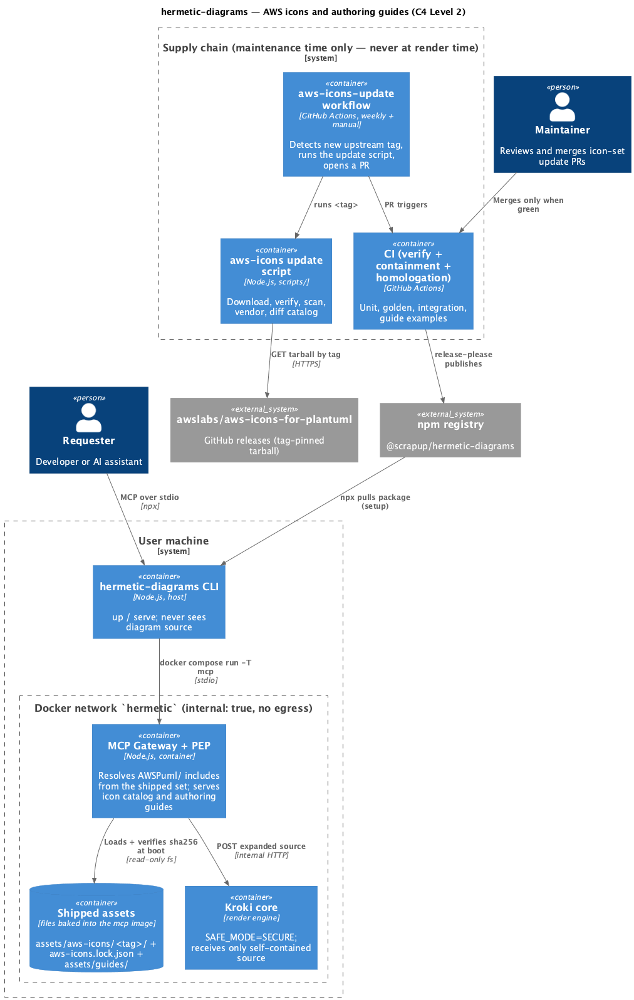
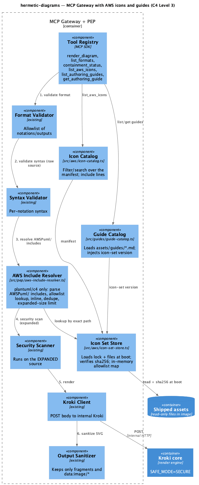
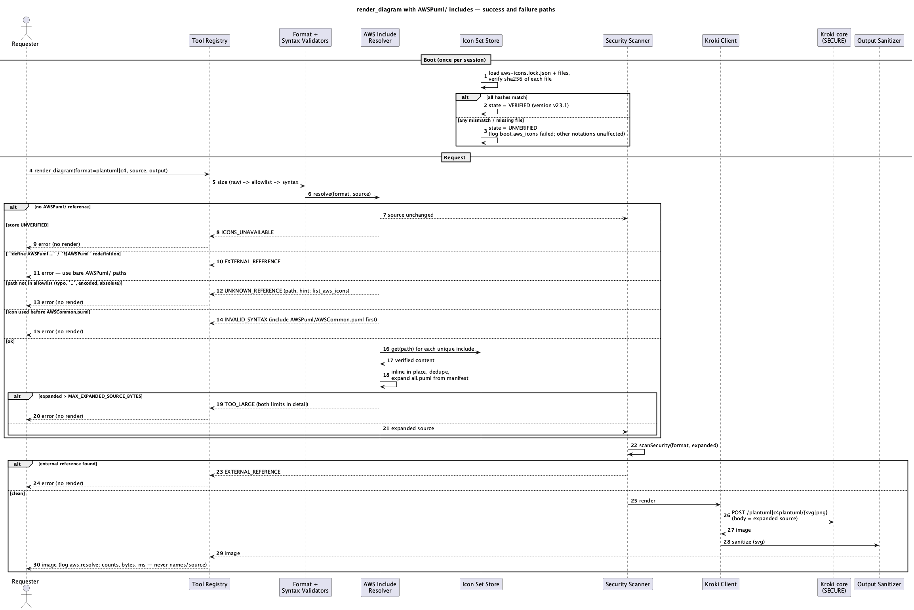
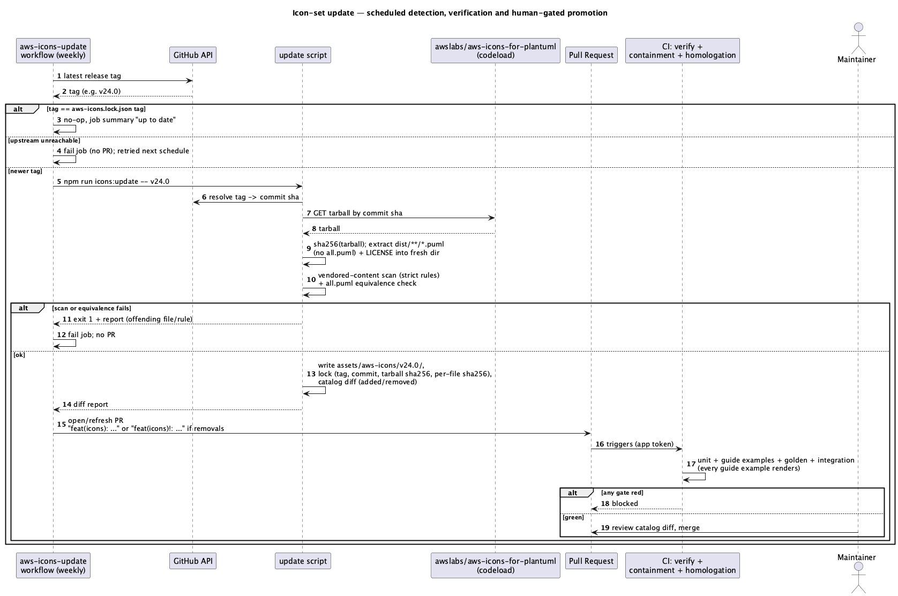

# Technical Plan: AWS architecture icons and authoring guides, contained

> SDD Phase 2 — the How. Prerequisite: approved `spec.md` (2026-10-14).
> Stack unchanged: Node.js 24 + strict TypeScript, MCP SDK (stdio), Docker Compose, Kroki core
> pinned by digest. No new runtime dependency. No database, no queue.

## 1. Architecture Overview

- **Main Decision:** vendor the upstream icon set (`awslabs/aws-icons-for-plantuml`, pinned tag)
  as **read-only files baked into the `mcp` image**, and add a new PEP step — the **AWS Include
  Resolver** — that replaces every `!include AWSPuml/...` with the verified file content **inside
  the MCP**, before the Security Scanner. Kroki receives a self-contained source and stays in
  `KROKI_SAFE_MODE=SECURE`; it never sees an include it would need to resolve.
- **Authoring guides** are versioned Markdown files shipped next to the icons and served by two new
  MCP tools. Every example inside them is executable and proven in CI.
- **Update path:** a maintainer script (`npm run icons:update -- <tag>`) + a weekly GitHub Actions
  workflow that opens a PR; promotion only through the existing containment/homologation gates and
  a human merge.
- **Affected repository:** `scrapup/hermetic-diagrams`.

**Facts measured on upstream v23.1 (2026-10-14)** — they drive the decisions below:

| Fact | Value | Consequence |
|---|---|---|
| `.puml` files in `dist/` | 859 (7.43 MB); 28 are `all.puml` (≈3.6 MB) | Ship individual icons only (3.80 MB); synthesize `all.puml` (D-04) |
| Icon file content | `sprite $X [64x64/16z] {…}`, `!function $XIMG()` returning ``, `!define` macros | No PNG/SVG fetch needed; `data:image/png` already allowed by the Output Sanitizer |
| `!include` inside upstream files | none (flat) | Resolver needs no transitive resolution for v23.1; nesting refused by design (D-05) |
| URLs outside comments | only `xmlns="http://www.w3.org/2000/svg"` in `AWSExperimental.puml` sprite lines | Exact allowlist entry in the vendored-content scan |
| Base files | `AWSCommon` (11.5 KB), `AWSSimplified`, `AWSExperimental`, `AWSC4Integration`, `AWSRaw` | All five shipped; `AWSC4Integration` covers the `c4` notation |
| Dark mode | `!$AWS_DARK = true` set **before** `AWSCommon` | Plain PlantUML variable, no resolver support needed; documented in guide |
| Licenses | icons CC-BY-ND 2.0, code MIT | Ship upstream `LICENSE*` unmodified + attribution (§5.4) |
| Upstream release asset | none; tag tarball via `codeload.github.com` (37.6 MB) | Script pins tag → commit sha → tarball sha256 |

### 1.1 Repository layout (new/changed)

| Path | Role |
|---|---|
| `assets/aws-icons/<tag>/**/*.puml` | Vendored icon set (no `all.puml`, no PNG) |
| `assets/aws-icons/<tag>/LICENSE`, `LICENSE-CODE` | Upstream licenses, unmodified |
| `aws-icons.lock.json` | Pin + integrity manifest + catalog (§3.1) |
| `assets/guides/*.md` | Authoring guides (§3.3) |
| `src/aws/icon-set-store.ts` | Boot load + sha256 verification; in-memory allowlist |
| `src/aws/icon-catalog.ts` | Search/filter for `list_aws_icons` |
| `src/pep/aws-include-resolver.ts` | New PEP step (§4.5) |
| `src/guides/guide-catalog.ts` + `guide-examples.ts` | Load guides; extract examples for tests |
| `src/server/tools/list-aws-icons.ts`, `authoring-guides.ts` | New tools |
| `scripts/aws-icons/update.ts` (+ `vendored-scan.ts`, `catalog-diff.ts`) | Maintainer update script (not shipped) |
| `.github/workflows/aws-icons-update.yml` | Weekly detection + PR |
| `THIRD_PARTY_NOTICES.md` | Attribution (shipped) |
| `Dockerfile`, `package.json#files` | Ship `assets/` + lock into the package and the image |

## 2. Solution Diagrams

### 2.1 C4 Level 2 — Containers



Source: [`diagrams/c4-container.puml`](diagrams/c4-container.puml)

### 2.2 C4 Level 3 — MCP Gateway components



Source: [`diagrams/c4-component.puml`](diagrams/c4-component.puml)

### 2.3 Sequence — render with AWS includes (success + failure)



Source: [`diagrams/sequence-render-aws.puml`](diagrams/sequence-render-aws.puml)

### 2.4 Sequence — icon-set update (success + failure)



Source: [`diagrams/sequence-icons-update.puml`](diagrams/sequence-icons-update.puml)

## 3. Data, Configuration, and Persistence

No database. All state is files shipped in the package/image plus in-memory structures built at
boot.

### 3.1 `aws-icons.lock.json` (repo root, shipped)

```json
{
  "$schemaVersion": 1,
  "upstream": "awslabs/aws-icons-for-plantuml",
  "tag": "v23.1",
  "commit": "string — 40-hex commit sha the tag resolved to",
  "tarballSha256": "string — 64-hex sha256 of the codeload tarball",
  "vendoredOn": "2026-10-14",
  "root": "assets/aws-icons/v23.1",
  "files": [
    {
      "path": "Compute/Lambda.puml",
      "kind": "icon | base | group",
      "category": "Compute",
      "name": "Lambda",
      "sha256": "string — 64-hex",
      "bytes": 3719
    }
  ],
  "categories": {
    "Storage": ["Backup", "SimpleStorageService", "..."]
  },
  "manifestSha256": "string — sha256 of the canonical JSON of `files`"
}
```

Validation at boot (Zod-free, hand-rolled type guards — no new dependency): `$schemaVersion === 1`,
`tag` matches `^v\d+(\.\d+)*$`, every `path` matches the path grammar (§4.5), no duplicates,
`root` equals `assets/aws-icons/<tag>`. A malformed lock is treated as `UNVERIFIED`.

### 3.2 In-memory structures (MCP)

| Structure | Built | Content |
|---|---|---|
| `IconSet.files: Map<string, string>` | boot | exact `AWSPuml/`-relative path → verified UTF-8 content |
| `IconSet.categories: Map<string, readonly string[]>` | boot | category → ordered icon paths (drives synthetic `all.puml`) |
| `IconSet.state` | boot | `VERIFIED` \| `UNVERIFIED` + reason code |
| `GuideCatalog: Map<GuideId, Guide>` | boot | id → title, summary, body (version placeholders resolved) |

Memory: ≈3.8 MB icons + guides; well inside the `mcp` container's 256 MB limit. Hashing at boot is
one pass over 3.8 MB (expected < 50 ms; measured in TF).

### 3.3 Authoring guides (`assets/guides/<id>.md`)

Guide ids (closed set, enforced by a unit test against `INPUT_FORMATS`):

| Id | Covers |
|---|---|
| `plantuml`, `c4`, `d2`, `graphviz`, `dbml`, `erd`, `vega`, `vega-lite` | One per supported notation |
| `aws-architecture` | `AWSCommon` + icons, groups (`AWSCloudGroup`, `AWSAccountGroup`, `RegionGroup`, `VPCGroup`, `AvailabilityZoneGroup`, `PublicSubnetGroup`/`PrivateSubnetGroup`, `AutoScalingGroupGroup`, `SecurityGroupGroup`) |
| `aws-sequence` | `<Icon>Participant` macros in sequence diagrams |
| `aws-c4` | `c4` notation + `AWSC4Integration` |
| `aws-simplified` | `AWSSimplified` / `AWSExperimental` styles |
| `aws-dark` | `$AWS_DARK = true` before `AWSCommon` |

File format: YAML-less front matter avoided; first line `# <title>`, second paragraph = summary.
Fixed sections: **When to use**, **Building blocks**, **Refused here (and what to use instead)**,
**Examples**. Examples are fenced blocks with an info string the test harness parses:

````
```hermetic-example format=plantuml output=svg
@startuml
!include AWSPuml/AWSCommon.puml
!include AWSPuml/Compute/Lambda.puml
Lambda(fn, "Handler", "Node.js 24")
@enduml
```
````

Placeholder `{{AWS_ICONS_VERSION}}` is replaced at load time with the lock's `tag`. No other
templating.

### 3.4 Configuration (new env, read in `src/config.ts`)

| Variable | Default | Rule |
|---|---|---|
| `MAX_EXPANDED_SOURCE_BYTES` | `2097152` (2 MiB) | Post-resolution limit (spec RN-06); must be ≥ `MAX_SOURCE_BYTES`, else falls back to default |
| `MAX_AWS_INCLUDES` | `200` | Max distinct `AWSPuml/` includes per source (local-DoS bound) |
| `AWS_ICONS_ROOT` | `/app/assets/aws-icons` | Read-only; not overridable to a path outside `/app/assets` (validated) |

## 4. Integration Contracts (MCP tools)

All additive. Existing contracts unchanged except the error enum (§4.6).

### 4.1 `render_diagram` (behavior extension)

Request/response unchanged. For `format ∈ {plantuml, c4}`, sources may contain
`!include AWSPuml/<path>` lines. Tool description gains one sentence pointing to
`list_authoring_guides`.

### 4.2 `list_aws_icons`

**Request:**
```json
{
  "category": "string — optional; exact category name, case-insensitive",
  "query": "string — optional; 1..64 chars; case-insensitive substring of the icon name",
  "limit": "integer — optional; 1..200; default 50"
}
```

**Response:**
```json
{
  "version": "v23.1",
  "total": 826,
  "returned": 2,
  "categories": ["Analytics", "Compute", "..."],
  "icons": [
    { "category": "Compute", "name": "Lambda", "include": "!include AWSPuml/Compute/Lambda.puml",
      "macros": ["Lambda(alias, label, technology)", "LambdaParticipant(alias, label, technology)"] }
  ],
  "base": ["!include AWSPuml/AWSCommon.puml", "!include AWSPuml/AWSSimplified.puml", "..."]
}
```

`macros` is derived from the manifest name (upstream convention `<Name>`, `<Name>Participant`),
not parsed from content. Registered always; if the store is `UNVERIFIED` it returns
`ICONS_UNAVAILABLE`.

### 4.3 `list_authoring_guides`

**Response:**
```json
{
  "awsIconsVersion": "v23.1",
  "guides": [
    { "id": "aws-architecture", "title": "AWS architecture diagrams", "summary": "string", "notation": "plantuml" }
  ]
}
```

### 4.4 `get_authoring_guide`

**Request:** `{ "id": "string — required; one of the listed ids" }`
**Response:** `{ "id": "string", "title": "string", "markdown": "string" }`
Unknown id → `INVALID_FORMAT`-style error with code `UNKNOWN_GUIDE` and the list of ids.

Guides are served as **tools** (not MCP prompts/resources) because tools are the only primitive
every target client supports uniformly (Claude Code, Copilot CLI); see §6.

### 4.5 AWS Include Resolver — internal contract

Position in the pipeline: after `validateSyntax`, before `scanSecurity` (which now runs on the
expanded source). Applies only to `plantuml` and `c4`; other notations pass through untouched.

Line grammar (after trimming; anything else containing `AWSPuml` is refused):

| Line | Action |
|---|---|
| `!include AWSPuml/<path>` or `!include_once AWSPuml/<path>` | Resolve |
| `!define AWSPuml …`, `!$AWSPuml = …`, `!global $AWSPuml …` | Refuse `EXTERNAL_REFERENCE` (redefinition) |
| `!include <awslib/...>` (PlantUML stdlib) | Untouched (existing behavior) |

`<path>` grammar: `^(?:[A-Za-z0-9]+/)?[A-Za-z0-9_]+\.puml$` — no `..`, no `%`, no leading `/`, no
backslash, max one directory level. Lookup is an **exact `Map.get`** on the grammar-valid string;
the input never reaches a filesystem call.

Rules:
1. Store `UNVERIFIED` and any `AWSPuml/` line present → `ICONS_UNAVAILABLE`.
2. Path not in the map → `UNKNOWN_REFERENCE` (detail: the offending path, plus "use
   list_aws_icons"). The path is the Requester's own input and is not logged.
3. `<Category>/all.puml` → synthetic content = concatenation of that category's icon files in
   manifest order (equivalence to upstream proven at update time, §5.5).
4. An icon/group include appearing before `AWSCommon.puml` (or `AWSSimplified`/`AWSExperimental`,
   which require it) → `INVALID_SYNTAX` with the fix.
5. Each distinct path is inlined once (first occurrence, in place); later duplicates become empty
   lines (line numbers preserved for Kroki error messages).
6. Distinct includes > `MAX_AWS_INCLUDES` or expanded bytes > `MAX_EXPANDED_SOURCE_BYTES` →
   `TOO_LARGE` (detail states both limits; checked incrementally — stops before building the full
   string).
7. Output is the expanded source; `scanSecurity(format, expanded, MAX_EXPANDED_SOURCE_BYTES)` runs
   on it unchanged (spec RN-04).

### 4.6 Error enum (additive)

`ERROR_CODES` gains: `UNKNOWN_REFERENCE`, `ICONS_UNAVAILABLE`, `UNKNOWN_GUIDE`. `TOO_LARGE` detail
distinguishes `source` vs `expanded`.

### 4.7 `containment_status` (extension)

```json
{ "awsIcons": { "state": "verified | unverified", "version": "v23.1", "reason": "string — optional" } }
```

Icon-set integrity does **not** affect `contained`: containment is the network + engine; a bad
icon set only disables the AWS feature (spec edge case "integrity check at startup" — decided here,
see §6).

## 5. Resilience, Security, and Error Handling

### 5.1 Failure Matrix

| Component | Failure | Strategy | Impact on Requester |
|---|---|---|---|
| Icon Set Store | Lock malformed / file missing / sha256 mismatch | `UNVERIFIED`; AWS includes refused; other notations unaffected; `boot.aws_icons` warn log | `ICONS_UNAVAILABLE`; `containment_status.awsIcons.state = unverified` |
| Resolver | Unknown path / escape attempt | `UNKNOWN_REFERENCE`, no render | Actionable error + discovery hint |
| Resolver | `AWSPuml` redefinition / upstream URL | `EXTERNAL_REFERENCE` (existing scanner also catches the URL) | Refusal + reserved-convention hint |
| Resolver | Expanded too large / too many includes | `TOO_LARGE` | States both limits |
| Kroki | Expanded source rejected (e.g. `` blocked in SECURE) | Map to `RENDER_ERROR`; **proven absent in TF spike** before shipping | n/a if spike passes |
| Guide Catalog | Guide file missing at boot | Fail the boot of the guide tools only (`list_authoring_guides` returns available ones; CI test makes this impossible in a release) | Fewer guides |
| Update workflow | Upstream unreachable | Job fails, no PR; next schedule retries | None (shipped set unchanged) |
| Update script | Integrity/scan/equivalence failure | Exit non-zero with offending file+rule; no PR | None |
| Update PR | Any CI gate red (incl. a guide example) | Not mergeable | None |

### 5.2 Security

- **Containment invariants unchanged:** no new network path; the `mcp` container still has no
  outbound client; Kroki stays `SECURE`; POST-with-body only.
- **Allowlist resolution:** grammar + exact map lookup; never `path.join` with input; assets dir
  is read-only in the image (`COPY --chown=root:root`, files `0444`, container user `node`).
- **Defense in depth on vendored content:** content is (a) scanned at update time with stricter
  rules (§5.5), (b) pinned by per-file sha256 verified at every boot, (c) re-scanned as part of the
  expanded source on every render.
- **The System is a safe source (decision 2026-10-14).** Everything the System itself ships and
  injects — vendored icons, synthetic `all.puml`, base files, guide text and guide examples — must
  never contain constructs that read outside the source: `!include*` (other than `AWSPuml/` in
  guides), `!import`, `!theme … from`, `%getenv`, `%load_json`, `%get_all_stdlib`, DTD/entities,
  URL schemes (except the exact SVG namespace literal). Enforced at three points: the update script
  (§5.5 step 4, blocks the update), a CI unit test that re-runs the same strict scan over the
  shipped `assets/` (catches manual edits), and the guide static check (§7).
- **Requester input is not changed by this feature.** `%load_json(...)` / `!import` written by the
  Requester are not refused by barrier 1; the decision to use them is the Requester's, and Kroki
  `SECURE` (barrier 3) plus the `internal: true` network (barrier 2) still keep any such read
  local/failed. The strict rules above apply to the System's own content only.

### 5.3 Observability (local only, RN-07/RN-12)

| Type | Event | When | Fields (never source, never icon names/paths) |
|---|---|---|---|
| Log (info) | `boot.aws_icons` | Boot | `state`, `version`, `files`, `durationMs` |
| Log (warn) | `boot.aws_icons` | Boot, unverified | `state`, `reason` (`lock_invalid` \| `file_missing` \| `hash_mismatch`), `count` |
| Log (info) | `aws.resolve` | Render with AWS includes | `includes` (count), `expandedBytes`, `durationMs` |
| Log (warn) | `request.rejected` | Resolver refusal | existing event; `code` only |
| Log (info) | `guides.ready` | Boot | `count` |

### 5.4 Licensing and attribution (spec RN-11)

- `assets/aws-icons/<tag>/LICENSE` and `LICENSE-CODE` copied verbatim from the tarball.
- `THIRD_PARTY_NOTICES.md` (new, in `package.json#files`): upstream name, URL, tag, commit,
  licenses (CC-BY-ND 2.0 for icons, MIT for code), statement that files are redistributed
  unmodified. Synthetic `all.puml` is an aggregation, not a modification of any file.
- README (EN/PT/JA): short "AWS icons" section with attribution line.

### 5.5 Update pipeline (maintainer side)

`scripts/aws-icons/update.ts <tag>` (run via `npm run icons:update -- <tag>`; executed by Node 24's
native type stripping — no `tsx`, no new dev dependency):

1. Resolve `<tag>` → commit sha via `GET https://api.github.com/repos/awslabs/aws-icons-for-plantuml/git/ref/tags/<tag>`.
2. Download `https://codeload.github.com/awslabs/aws-icons-for-plantuml/tar.gz/<commit>` into a
   fresh temp dir; compute sha256. Integrity anchor = TLS + commit-pinned URL + sha256 recorded in
   the lock and reviewed in the PR (upstream does not sign releases).
3. Extract with `tar` restricted to `*/dist/**/*.puml` and `*/LICENSE*`; reject symlinks, absolute
   paths, `..`, and any path not matching the grammar (§4.5).
4. **Vendored-content scan** (strict, per file, after stripping `'` comment lines): refuse any
   `!include*`, `!import`, `!theme`, `%getenv`, `%load_json`, `%get_all_stdlib`, `<!DOCTYPE`/
   `<!ENTITY`, `/`, delete the previous tag dir, regenerate the lock (sorted,
   canonical JSON), compute catalog diff vs the previous lock: `added[]`, `removed[]`, and
   `renamedCandidates[]` (removed/added pairs in the same category with case-insensitive name
   similarity ≥ 0.8 — informative only; any removal is breaking).
7. Print a Markdown report (used as PR body) and exit `0`, or exit `1` on any failure.

`.github/workflows/aws-icons-update.yml`:

| Property | Value |
|---|---|
| Triggers | `schedule: '0 6 * * 1'` (weekly, Monday 06:00 UTC) + `workflow_dispatch` (input `tag`) |
| Permissions | job-level `contents: write`, `pull-requests: write`; top-level `{}` |
| Detection | `gh api repos/awslabs/aws-icons-for-plantuml/releases/latest` vs lock `tag` |
| PR | branch `chore/aws-icons-<tag>`; title `feat(icons): update AWS icons to <tag>` or `feat(icons)!: …` when `removed[]` is non-empty; body = script report |
| Token | GitHub App installation token (`actions/create-github-app-token`, pinned SHA) so the PR triggers `ci.yml` (PRs opened with `GITHUB_TOKEN` do not trigger workflows) |
| Actions | pinned by commit SHA (existing repo policy) |

`ci.yml` `homologation` job: extend the guarded-file check from `images.lock` to
`aws-icons.lock.json` and `assets/**` — a change there requires the `containment` job (golden +
integration + guide examples) to have passed.

Versioning note: the package is pre-1.0 (`0.4.x`); release-please maps `feat!` to a **minor** bump
while < 1.0 unless `bump-minor-pre-major` is changed. The breaking signal is kept in the commit and
CHANGELOG either way.

## 6. Rationale and Trade-offs

| Decision | Rejected Alternative | Rationale |
|---|---|---|
| D-01 Resolve includes in the MCP | Mount icons into Kroki + `PLANTUML_INCLUDE_PATH` | Kroki `SECURE` blocks filesystem includes; relaxing it weakens barrier 3 for every notation |
| D-02 Vendored set | PlantUML stdlib `<awslib/...>` | Stdlib version is tied to the Kroki digest; no control over updates (kept working as-is) |
| D-03 `AWSPuml/` reserved prefix | `<aws/...>` | Collides with stdlib names; `AWSPuml/` matches upstream docs (copy-paste) |
| D-04 Synthetic `all.puml` | Ship upstream `all.puml` | Halves package growth (≈3.6 MB); equivalence proven at update time |
| D-05 Refuse nested includes in vendored files | Transitive resolution | Upstream is flat today; nesting would be a new behavior worth reviewing, so update fails loudly |
| D-06 Integrity failure disables AWS only | Refuse to boot | Containment does not depend on icons (content is re-scanned per render); degrading keeps other notations working; state visible in `containment_status` |
| D-07 Guides as tools | MCP prompts/resources | Uniform support across target clients; prompts/resources can be added later without breaking |
| D-08 Guides in Markdown with executable examples | Guides in TS strings | Reviewable docs; examples extracted and rendered in CI (spec RN-14) |
| D-09 Weekly bot PR via GitHub App token | `GITHUB_TOKEN` | Only an app/PAT token triggers CI on the bot PR; app token is scoped and short-lived |
| D-10 No new runtime dependency | YAML/front-matter parser, Zod | Smaller supply-chain surface; formats are trivial |

## 7. Testing, CI, and Homologation

| Layer | Coverage |
|---|---|
| Unit — Icon Set Store | valid lock; malformed lock; missing file; hash mismatch; grammar violations in lock |
| Unit — Resolver | each rule of §4.5 (one test per row), dedupe, synthetic `all.puml`, order rule, both limits, non-AWS notations untouched, `c4` path |
| Unit — Scanner on expanded | expanded source with redefinition / injected URL still refused |
| Unit — Catalog / tools | filters, limits, empty result, `UNVERIFIED` path, contract shapes |
| Unit — Guides | one guide per `INPUT_FORMATS` entry and per AWS kind; no unsupported notation listed; every `hermetic-example` passes the full PEP (format → syntax → resolver → scanner) without Docker; static check that no guide text contains refused constructs |
| Unit — Shipped content | the strict vendored-content scan (§5.5 step 4) runs over every file in `assets/aws-icons/**` and `assets/guides/**`; any hit fails CI |
| Unit — Update script | vendored scan rules (fixtures), path/symlink rejection, equivalence check, catalog diff (added/removed/renamed candidates) — network mocked |
| Integration (compose) | every guide example rendered to SVG and PNG against real Kroki; AWS architecture + sequence + c4 + dark + simplified render; sanitized SVG retains `data:image/png` |
| Golden exfiltration | new cases: upstream URL include; `!define AWSPuml https://sink/`; `AWSPuml/../` escape — sink never hit |
| Package/integration | packed tarball contains `assets/aws-icons/<tag>`, lock, guides, notices; image contains them read-only |
| Performance | resolver P95 < 50 ms for 50 includes (unit benchmark with threshold, spec SLA) |

**Spike gate (first TF):** prove against the pinned Kroki digest that an expanded v23.1 source
(`AWSCommon` + icons, including `$XIMG()` / ``) renders in `SECURE`, and measure
expanded sizes. If it fails, stop and revise this plan before further TFs.

### Spike result (TF-105-01, 2026-10-14)

Harness: `test/spikes/aws-icons/render-spike.ts`, run in a one-off `node:24` container attached to
the `internal: true` network, POSTing to the pinned Kroki (`KROKI_SAFE_MODE=SECURE`, unchanged
`compose.yaml`). Upstream: tag `v23.1` → commit `b788ba79e8cd028be274761f0fadd8bf3b711acd`,
tarball sha256 `c613008f62d61e9594ad99661ace6678d06aaeea6d52ee6e4c27338750a5c30f` (37.6 MB,
861 members matched `dist/**/*.puml` + `LICENSE*`, zero symlinks).

| Case | Expanded source | SVG (status / bytes / ms) | PNG (status / bytes / ms) | Sanitized SVG keeps `data:image/png` |
|---|---|---|---|---|
| (a) `AWSCommon` + Lambda + S3, entity macros | 19,760 B | 200 / 18,463 / 322 (cold) | 200 / 14,951 / 52 | yes (2) |
| (b) same, `$LambdaIMG()` `` | 19,776 B | 200 / 17,366 / 47 | 200 / 12,260 / 43 | yes (2) |
| (c) `c4` + `AWSC4Integration` + `AWSCommon` + 2 icons | 22,828 B | 200 / 28,752 / 122 | 200 / 22,120 / 105 | yes (3) |
| (d) `!$AWS_DARK = true` before `AWSCommon` | 15,281 B | 200 / 11,365 / 31 | 200 / 8,921 / 31 | yes (1) |
| (e) `AWSCommon` + upstream `Storage/all.puml` | 450,337 B | 200 / 361,057 / 159 | 200 / 307,526 / 155 | yes (2) |

Additional evidence: the shipped `scanSecurity` accepts all five expanded sources (`plantuml` and
`c4`) and all 859 upstream `.puml` files; the only URL schemes outside `'` comments are the two
`xmlns="http://www.w3.org/2000/svg"` literals in `AWSExperimental.puml`.

Implementation notes surfaced by the spike: (1) macOS ships bsdtar (no `--wildcards`), so the update
script extracts with an explicit member list (`tar -T`), portable across bsdtar and GNU tar;
(2) `git/ref/tags/<tag>` may return an annotated `tag` object, which must be dereferenced to the
commit; (3) a single category `all.puml` expands to ~450 KB, well within the 2 MiB default.

**Decision: proceed** — D-01 holds; no plan revision needed.
