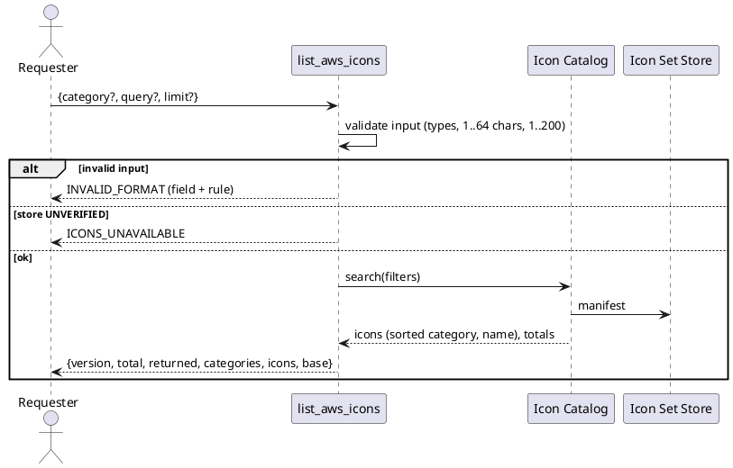
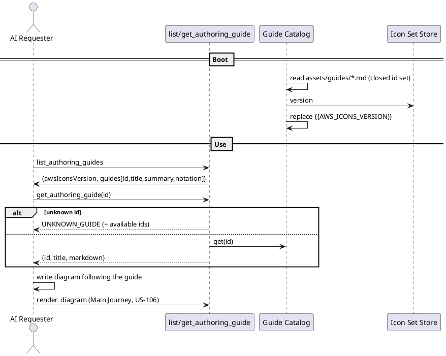

# Execution Backlog: AWS architecture icons and authoring guides, contained (hermetic-diagrams)

> SDD Phase 3. Prerequisites: approved `spec.md` and `plan.md` (2026-10-14).
> Personal project — no Sami stack. Node.js 24 + strict TypeScript, MCP SDK (stdio), Docker
> Compose, Kroki core pinned by digest. **No new runtime dependency** (plan D-10).

## Reference Epic

**Epic:** E-00 — hermetic-diagrams (personal initiative; no PM). Macro context: `spec.md` +
`plan.md` in this folder.

---

## Traceability

| Requirement (spec.md) | Decision (plan.md) | User Story | Tasks |
|---|---|---|---|
| RN-01, RN-07 | Vendored set + `aws-icons.lock.json` (§3.1), baked into the image (§1.1) | US-105 | TF-105-02, TF-105-03, TF-105-05 |
| RN-09 | Strict vendored-content scan + `all.puml` equivalence (§5.5 steps 3–5) | US-105 | TF-105-02 |
| RN-11 | Upstream licenses verbatim + `THIRD_PARTY_NOTICES.md` (§5.4) | US-105 | TF-105-03 |
| §5.2 "System is a safe source" | Shipped-content scan in CI | US-105 | TF-105-03 |
| Spec edge case "integrity check at startup" | D-06: unverified set disables AWS only (§4.7, §5.1) | US-105 | TF-105-04 |
| Plan §7 spike gate | Prove `` + expanded source in `SECURE` | US-105 | TF-105-01 |
| RN-02, RN-03, RN-04, RN-05, RN-06 | AWS Include Resolver (§4.5) before Security Scanner | US-106 | TF-106-01, TF-106-02, TF-106-03 |
| RN-12 | Local logs with counts only (§5.3) | US-106 | TF-106-03 |
| Spec success criterion "golden covers AWS paths" | New golden cases (§7) | US-106 | TF-106-04 |
| Alt. Journey A (discovery) | `list_aws_icons` (§4.2) | US-107 | TF-107-01 |
| RN-13, RN-15, RN-16, Alt. Journey F | Guides as tools (D-07), Markdown + `hermetic-example` (D-08) | US-108 | TF-108-01, TF-108-02, TF-108-03 |
| RN-14 | Every example passes the PEP (unit) and renders (integration) | US-108 | TF-108-01, TF-108-04 |
| Alt. Journey D, RN-08, RN-10 | Catalog diff, weekly workflow with app token (D-09), homologation gate | US-109 | TF-109-01, TF-109-02, TF-109-03 |

Reference diagrams (from `plan.md` §2): [C4 N2](diagrams/c4-container.png) ·
[C4 N3](diagrams/c4-component.png) · [render sequence](diagrams/sequence-render-aws.png) ·
[update sequence](diagrams/sequence-icons-update.png).

---

## User Stories Overview

| # | User Story | Value Delivered | Depends on |
|---|---|---|---|
| US-105 | Shipped, verified AWS icon set | The package and image carry a pinned, integrity-checked, containment-scanned AWS icon set; nothing is fetched at render time | — |
| US-106 | Render AWS diagrams with `AWSPuml/` includes | Requesters render AWS architecture/sequence/C4 diagrams with zero egress | US-105 |
| US-107 | AWS icon discovery | Requesters find valid icon names and include lines without guessing | US-105 |
| US-108 | Authoring guides for every notation and AWS diagram kind | AI Requesters write valid diagrams on the first attempt | US-106, US-107 |
| US-109 | Automated, human-gated icon-set updates | New upstream releases arrive as reviewable PRs, promoted only after containment is re-proven | US-105, US-108 |

---

## US-105: Shipped, verified AWS icon set

**Epic:** E-00 · **System:** scrapup/hermetic-diagrams · **Estimate:** 8 SP · **Priority:** P0

### Value Narrative
> **As a** Requester, **I want** the AWS icon set to be part of the installed System, pinned and
> verified, **so that** AWS diagrams can be rendered without anything being fetched from outside.

### Business Context
Upstream documents consumption by URL, which the System refuses. This story brings the set inside
the trust boundary: downloaded once by the maintainer, scanned with strict rules, pinned by
sha256, shipped in the npm package and the `mcp` image, and re-verified at every boot. It starts
with a spike that de-risks the whole feature (plan §7).

### Acceptance Criteria
- [ ] The spike proves an expanded v23.1 source renders in the pinned Kroki under `SECURE` (SVG + PNG).
- [ ] `assets/aws-icons/v23.1/` + `aws-icons.lock.json` exist, generated by the script, with no `all.puml` and no PNG.
- [ ] Every shipped file passes the strict scan in CI; licenses and notices are shipped.
- [ ] The MCP verifies the set at boot and reports `containment_status.awsIcons`; a tampered file yields `unverified` without affecting other notations.
- [ ] The packed tarball and the built image contain the assets, read-only in the image.

### Applicable Business Rules
| # | Rule | Type |
|---|---|---|
| RN-01 | Never fetched at render time | Restrictive |
| RN-07 | One pinned release with recorded fingerprints | Mandatory |
| RN-09 | Upstream definitions that reach outside block the update | Restrictive |
| RN-11 | Licenses and attribution kept; content unmodified | Restrictive |

### Task Sequencing
| # | Task | Scope | Depends on |
|---|---|---|---|
| TF-105-01 | Spike: expanded v23.1 source renders in `SECURE` | Validation | — |
| TF-105-02 | Update script core: fetch, extract, strict scan, equivalence, lock | Supply chain tooling | TF-105-01 |
| TF-105-03 | Vendor v23.1, licenses, notices, shipped-content CI scan | Assets | TF-105-02 |
| TF-105-04 | Icon Set Store: boot verification + `containment_status.awsIcons` | Runtime | TF-105-03 |
| TF-105-05 | Ship assets in the npm package and the `mcp` image | Packaging | TF-105-03 |

### Tasks

#### TF-105-01: [hermetic-diagrams] Spike — expanded v23.1 source renders under `SECURE`
**User Story:** US-105 · **Priority:** P0

##### 1. Description & Objective
> **As the** maintainer, **I want** empirical proof that Kroki (pinned digest, `SECURE`) renders a
> self-contained source built from v23.1 files, **so that** the plan's core decision (D-01) is
> validated before any production code is written.

##### 2. Technical Specification
**2.1 Deliverable:** a throwaway harness under `test/spikes/aws-icons/` (not in `vitest` projects)
plus a findings note appended to `plan.md` §7 ("Spike result").
**2.2 Procedure:** with `node dist/cli/bin.js up` stack running, build by hand (concatenation) three
sources from the v23.1 tarball: (a) `AWSCommon` + `Compute/Lambda` + `Storage/SimpleStorageService`
using entity macros; (b) the same using `$LambdaIMG()` (``); (c) `c4`
with `AWSC4Integration` + `AWSCommon` + two icons; (d) `$AWS_DARK = true` variant; (e)
`Storage/all.puml` content. POST each to `kroki:8000` from inside the network (a one-off
`docker compose run` container) for `svg` and `png`.
**2.3 Measure:** expanded byte size per case; render duration; whether the sanitized SVG keeps the
`data:image/png` images (run `sanitizeSvg` on the output).
**2.4 Zero Trust:** the tarball is untrusted data — extract into a fresh scratch directory, never
execute anything from it.

##### 3. Visual Model
`plan.md` §2.3 (only the Kroki leg is exercised).

##### 4. Execution Guidance
**4.3 Validation:** all five cases return HTTP 200 with a non-empty image; sanitized SVG still
shows icons.
**4.4 Constraints:** no change to `compose.yaml`, `KROKI_SAFE_MODE` or any `src/` file.
**4.6 Exit criteria / gate:** if any case fails because of `SECURE`, **stop the backlog** and
return to Phase 2 with the evidence.

##### 5. Definition of Done
- [ ] Five cases rendered (SVG + PNG) and results recorded in `plan.md` §7 with sizes and timings.
- [ ] Decision recorded: proceed / revise plan.

---

#### TF-105-02: [hermetic-diagrams] Update script core — fetch, extract, strict scan, equivalence, lock
**User Story:** US-105 · **Priority:** P0

##### 1. Description & Objective
> **As the** maintainer, **I want** a deterministic script that turns an upstream tag into a
> verified vendored set and lock file, **so that** the only way icons enter the repo is through
> the containment rules.

##### 2. Technical Specification
**2.1 Interception points (create):**
- `scripts/aws-icons/update.ts` — entry (`npm run icons:update -- <tag>`), Node 24 native type stripping.
- `scripts/aws-icons/fetch.ts` — tag → commit sha (`api.github.com/.../git/ref/tags/<tag>`), tarball download from `codeload.github.com/.../tar.gz/<commit>` to a fresh temp dir, sha256.
- `scripts/aws-icons/extract.ts` — `tar` restricted to `*/dist/**/*.puml` and `*/LICENSE*`; reject symlinks, absolute paths, `..`, and paths outside the grammar `^(?:[A-Za-z0-9]+/)?[A-Za-z0-9_]+\.puml$`.
- `scripts/aws-icons/vendored-scan.ts` — strict rules of plan §5.5 step 4 (after stripping `'` comment lines): refuse `!include*`, `!import`, `!theme`, `%getenv`, `%load_json`, `%get_all_stdlib`, `<!DOCTYPE`/`<!ENTITY`, ` **As the** maintainer, **I want** the v23.1 set committed with its licenses and attribution and
> guarded by a CI scan, **so that** the System's own content is provably a safe source.

##### 2. Technical Specification
**2.1 Interception points:**
- `assets/aws-icons/v23.1/**` + `LICENSE` + `LICENSE-CODE` — produced by TF-105-02 (no hand edits).
- `aws-icons.lock.json` — produced by TF-105-02.
- `THIRD_PARTY_NOTICES.md` (create) — upstream, URL, tag, commit, licenses (CC-BY-ND 2.0 icons, MIT code), "redistributed unmodified; `all.puml` is synthesized by aggregation".
- `src/docs/shipped-content.spec.ts` (create, unit) — runs the strict scan from `scripts/aws-icons/vendored-scan.ts` over every file in `assets/aws-icons/**` and (once they exist) `assets/guides/**`; also asserts every file listed in the lock exists and vice versa.
- `.gitattributes` — `assets/aws-icons/** -text` to prevent line-ending rewrites that would break hashes on Windows checkouts.

##### 4. Execution Guidance
**4.3 Validation:** flip one byte in a vendored file locally → `shipped-content.spec.ts` (lock
consistency) fails.
**4.4 Constraints:** commit the vendored set in its own commit (`chore(icons): vendor AWS icons v23.1`) to keep review diffs readable.

##### 5. Definition of Done
- [ ] Assets, lock, licenses, notices committed.
- [ ] Shipped-content test green on the Windows/macOS/Linux matrix.

---

#### TF-105-04: [hermetic-diagrams] Icon Set Store — boot verification and `containment_status.awsIcons`
**User Story:** US-105 · **Priority:** P0

##### 1. Description & Objective
> **As the** MCP gateway, **I want** to load and verify the shipped set at boot into an in-memory
> allowlist, **so that** only verified content can ever be inlined, and a bad set disables only
> the AWS feature (D-06).

##### 2. Technical Specification
**2.1 Interception points:**
- `src/aws/icon-set-store.ts` (create) — `loadIconSet(root, lockPath): IconSet` reading the lock, validating it with hand-rolled type guards (plan §3.1 rules), reading each file, comparing sha256; result `{ state: 'VERIFIED' | 'UNVERIFIED', reason?, version, files: Map, categories: Map }`. Reasons: `lock_invalid`, `file_missing`, `hash_mismatch`.
- `src/config.ts` — `awsIconsRoot` from `AWS_ICONS_ROOT` (default `/app/assets/aws-icons`), rejected (fallback to default) if it does not resolve under `/app/assets` — config only; resolver limits come in TF-106-01.
- `src/index.ts` — load at boot, pass to `buildServer`.
- `src/server/tools/containment-status.ts` — add `awsIcons: { state, version, reason? }` (plan §4.7); `contained` unaffected.
- `src/logger.ts` usage — `boot.aws_icons` info/warn (plan §5.3).
- Unit tests: valid set; malformed lock; missing file; hash mismatch; root outside `/app/assets`; containment_status shape in both states.

**2.4 Zero Trust:** lock paths are re-validated against the grammar before any `fs` call; a path
failing it makes the whole set `UNVERIFIED` (`lock_invalid`).

##### 3. Visual Model
`plan.md` §2.3 "Boot" block.

##### 4. Execution Guidance
**4.3 Validation:** boot timing logged (`durationMs`); expected < 50 ms for 3.8 MB.
**4.6 Exit criteria:** `containment_status` reports `verified v23.1` against the real assets.

##### 5. Definition of Done
- [ ] Store + tests green; no source/path ever logged.
- [ ] `containment_status` contract updated in `plan.md` §4.7 if the shape changed during implementation.

---

#### TF-105-05: [hermetic-diagrams] Ship assets in the npm package and the `mcp` image
**User Story:** US-105 · **Priority:** P0

##### 1. Description & Objective
> **As the** Operator, **I want** the icon set present in the installed package and baked
> read-only into the image, **so that** `up` produces a gateway that can serve AWS icons offline.

##### 2. Technical Specification
**2.1 Interception points:**
- `package.json#files` — add `assets`, `aws-icons.lock.json`, `THIRD_PARTY_NOTICES.md`.
- `Dockerfile` (runtime stage) — `COPY --chown=root:root assets ./assets` and `COPY --chown=root:root aws-icons.lock.json ./`; `chmod -R a-w /app/assets` before `USER node`.
- `.dockerignore` — ensure `assets/` and the lock are not excluded.
- `test/integration/package.spec.ts` — packed tarball contains assets, lock, notices.
- `test/integration/render.spec.ts` (or a new `image.spec.ts`) — inside the built image, `/app/assets/aws-icons/v23.1/AWSCommon.puml` exists and is not writable by `node`.

##### 4. Execution Guidance
**4.3 Validation:** `npm pack --dry-run` lists the assets; report the tarball size delta in the PR.
**4.4 Constraints:** do not change `compose.yaml` (no volumes — assets are baked).

##### 5. Definition of Done
- [ ] Package/image integration tests green.
- [ ] Package size delta recorded in the PR description.

---

## US-106: Render AWS diagrams with `AWSPuml/` includes

**Epic:** E-00 · **System:** scrapup/hermetic-diagrams · **Estimate:** 8 SP · **Priority:** P0

### Value Narrative
> **As a** Requester, **I want** to write `!include AWSPuml/...` and get an AWS-styled diagram,
> **so that** I produce AWS architecture diagrams without exposing them to any external service.

### Business Context
This is the user-visible capability. The resolver inlines only verified, allowlisted files and
hands an expanded source to the unchanged Security Scanner, keeping every MVP barrier intact.

### Acceptance Criteria
- [ ] `plantuml` and `c4` sources with `AWSPuml/` includes render (SVG/PNG).
- [ ] Unknown paths, escapes, redefinitions, wrong order and oversize are refused before rendering with the plan §4.6 codes.
- [ ] Golden exfiltration covers the AWS vectors; the sink is never hit.
- [ ] Logs contain only counts, bytes and duration.

### Applicable Business Rules
| # | Rule | Type |
|---|---|---|
| RN-02 | Reserved references resolve only against the shipped set (fail-closed) | Restrictive |
| RN-03 | No relaxation of external-reference refusal | Restrictive |
| RN-04 | Every containment check runs on the expanded source | Mandatory |
| RN-05 | Available in `plantuml` and `c4` | Mandatory |
| RN-06 | Two size limits | Mandatory |
| RN-12 | No names/paths/content in logs | Restrictive |

### Visual Model (US scope)
Multi-component flow with non-trivial failure paths: [C4 N2](diagrams/c4-container.png) and
[render sequence (success + failure)](diagrams/sequence-render-aws.png) from `plan.md` §2.

### Task Sequencing
| # | Task | Scope | Depends on |
|---|---|---|---|
| TF-106-01 | Config limits + new error codes | Contract | — |
| TF-106-02 | AWS Include Resolver (pure module) | PEP | TF-106-01, TF-105-04 |
| TF-106-03 | Wire resolver into the render pipeline + observability + performance check | Pipeline | TF-106-02 |
| TF-106-04 | Golden exfiltration + integration cases for AWS | Validation | TF-106-03, TF-105-05 |

### Tasks

#### TF-106-01: [hermetic-diagrams] Config limits and new error codes
**User Story:** US-106 · **Priority:** P0

##### 1. Description & Objective
> **As the** PEP, **I want** the resolver's limits and error codes defined in the shared contract,
> **so that** refusals are stable and configurable.

##### 2. Technical Specification
**2.1 Interception points:**
- `src/config.ts` — `maxExpandedSourceBytes` (`MAX_EXPANDED_SOURCE_BYTES`, default 2 MiB; falls back to default if `< maxSourceBytes`), `maxAwsIncludes` (`MAX_AWS_INCLUDES`, default 200).
- `src/domain.ts` — `ERROR_CODES` += `UNKNOWN_REFERENCE`, `ICONS_UNAVAILABLE`, `UNKNOWN_GUIDE`.
- `src/server/error-mapper.ts` — map the new codes (messages actionable, no source echo).
- Unit tests for config parsing edge cases and mapper output.

##### 5. Definition of Done
- [ ] Config + mapper tests green; `plan.md` §4.6 matches the code.

---

#### TF-106-02: [hermetic-diagrams] AWS Include Resolver
**User Story:** US-106 · **Priority:** P0

##### 1. Description & Objective
> **As the** PEP, **I want** a pure function that turns a source with `AWSPuml/` includes into a
> self-contained source using only the verified set, **so that** Kroki never needs to resolve an
> include.

##### 2. Technical Specification
**2.1 Interception points (create):** `src/pep/aws-include-resolver.ts` —
`resolveAwsIncludes(format, source, iconSet, limits): { source: string; includes: number; expandedBytes: number }`.
Implements exactly plan §4.5:
1. Only `plantuml` / `c4`; others returned untouched.
2. Line grammar: `!include` / `!include_once` + `AWSPuml/<path>`; redefinitions (`!define AWSPuml`, `!$AWSPuml =`, `!global $AWSPuml`) → `EXTERNAL_REFERENCE`; any other line mentioning `AWSPuml/` in an include position → `UNKNOWN_REFERENCE`.
3. `<path>` grammar check, then exact `Map.get`; miss → `UNKNOWN_REFERENCE` (detail = path + "use list_aws_icons").
4. Store `UNVERIFIED` + any AWS include → `ICONS_UNAVAILABLE`.
5. `<Category>/all.puml` → synthetic concatenation from `iconSet.categories`.
6. Icon/group/`AWSSimplified`/`AWSExperimental` before `AWSCommon.puml` → `INVALID_SYNTAX` with the fix.
7. Dedupe (first occurrence inlined; duplicates → empty line).
8. Incremental size accounting: distinct includes > `maxAwsIncludes` or bytes > `maxExpandedSourceBytes` → `TOO_LARGE` (detail: `expanded` + both limits), stopping before materializing the full string.

**Tests (`aws-include-resolver.spec.ts`):** one test per rule; `..`, `%2e%2e`, leading `/`,
backslash, two directory levels; `!include <awslib/...>` untouched; mixed CRLF line endings;
line-number preservation; `c4` + `AWSC4Integration`; `$AWS_DARK` before `AWSCommon` passes through.

**2.4 Zero Trust:** the function receives the in-memory `IconSet`; it has no `fs` import (enforced
by an ESLint `no-restricted-imports` override for this file).

##### 5. Definition of Done
- [ ] All rules covered by tests; file has no `fs`/`path` import.

---

#### TF-106-03: [hermetic-diagrams] Wire the resolver into the render pipeline
**User Story:** US-106 · **Priority:** P0

##### 1. Description & Objective
> **As the** render pipeline, **I want** to run the resolver between syntax validation and the
> security scan, **so that** the scanner always inspects exactly what Kroki will receive.

##### 2. Technical Specification
**2.1 Interception points:**
- `src/render/render-pipeline.ts` — order becomes: size(raw) → format → syntax → **resolve** → `scanSecurity(format, expanded, maxExpandedSourceBytes)` → guard → Kroki → sanitizer. `RenderPipelineDeps` gains `iconSet`.
- `src/server/build-server.ts` / `src/server/tools/render-diagram.ts` — pass `iconSet`.
- Log `aws.resolve` (`includes`, `expandedBytes`, `durationMs`) only when `includes > 0`.
- Unit tests: pipeline with mocked Kroki receives the expanded body; a redefinition injected via expansion is still caught by the scanner; non-AWS renders unchanged.
- Performance test: 50 distinct includes, P95 of 200 runs < 50 ms (skipped on CI if `process.env.CI_PERF_SKIP`; never skipped locally).

##### 5. Definition of Done
- [ ] Pipeline tests green; existing render tests unchanged and green.
- [ ] Performance threshold met and number recorded in the PR.

---

#### TF-106-04: [hermetic-diagrams] Golden exfiltration and integration cases for AWS
**User Story:** US-106 · **Priority:** P0

##### 1. Description & Objective
> **As the** maintainer, **I want** the containment proofs to cover the AWS vectors and real AWS
> renders, **so that** the feature is promoted only with evidence.

##### 2. Technical Specification
**2.1 Interception points:**
- `test/golden/exfiltration.spec.ts` — cases: upstream URL include (`raw.githubusercontent.com/.../AWSCommon.puml` rewritten to the sink); `!define AWSPuml http://<sink>/`; `AWSPuml/../` escape. Assert refusal **and** zero sink hits.
- `test/integration/render.spec.ts` — render through the MCP: architecture with groups (`AWSCloudGroup`, `VPCGroup`, `PublicSubnetGroup`), sequence with `LambdaParticipant`, `c4` with `AWSC4Integration`, dark mode, `AWSSimplified`, `Storage/all.puml`; SVG + PNG; sanitized SVG still contains `data:image/png`.
- `containment_status.awsIcons.state === 'verified'` asserted in the compose suite.

##### 5. Definition of Done
- [ ] `npm run test:golden` and `npm run test:integration` green locally and in CI.

---

## US-107: AWS icon discovery

**Epic:** E-00 · **System:** scrapup/hermetic-diagrams · **Estimate:** 2 SP · **Priority:** P1

### Value Narrative
> **As a** Requester, **I want** to search the shipped AWS icons by category or name,
> **so that** I use valid include lines and macros instead of guessing.

### Acceptance Criteria
- [ ] `list_aws_icons` returns version, totals, categories, matching icons with `include` and `macros`, and the base includes.
- [ ] Empty result is not an error; `UNVERIFIED` set returns `ICONS_UNAVAILABLE`.

### Applicable Business Rules
| # | Rule | Type |
|---|---|---|
| RN-07 | Discovery reports the icon-set version in force | Mandatory |

### Visual Model (US scope — single container, no messaging)



### Task Sequencing
| # | Task | Scope | Depends on |
|---|---|---|---|
| TF-107-01 | Icon Catalog + `list_aws_icons` tool | Tool | TF-105-04 |

### Tasks

#### TF-107-01: [hermetic-diagrams] Icon Catalog and `list_aws_icons` tool
**User Story:** US-107 · **Priority:** P1

##### 1. Description & Objective
> **As the** MCP, **I want** a read-only search over the manifest exposed as a tool, **so that**
> Requesters discover icons offline.

##### 2. Technical Specification
**2.1 Interception points (create/update):**
- `src/aws/icon-catalog.ts` — `searchIcons(iconSet, { category?, query?, limit })`; case-insensitive category match and name substring; sorted by category then name; `macros` derived from name (`<Name>(alias, label, technology)`, `<Name>Participant(alias, label, technology)`; groups: `<Name>Group(alias, label)`), not parsed from content.
- `src/server/tools/list-aws-icons.ts` — tool registration with input schema (plan §4.2), always registered.
- `src/server/build-server.ts` — register.
- Unit tests: filters, limit bounds, empty result, invalid inputs, `UNVERIFIED`, response shape snapshot.

##### 5. Definition of Done
- [ ] Tool listed by the MCP; tests green; contract matches `plan.md` §4.2.

---

## US-108: Authoring guides for every notation and AWS diagram kind

**Epic:** E-00 · **System:** scrapup/hermetic-diagrams · **Estimate:** 8 SP · **Priority:** P1

### Value Narrative
> **As an** AI Requester, **I want** the System to teach me how to write each supported notation
> and each kind of AWS diagram, **so that** my first render succeeds and I never reach for
> internet idioms the System refuses.

### Business Context
Without guidance, assistants fall back on remote includes and public-renderer habits. Guides are
shipped, versioned, offline, and every example is proven by the same PEP and by a real render.

### Acceptance Criteria
- [ ] `list_authoring_guides` lists 13 guides (8 notations + 5 AWS kinds) with the icon-set version.
- [ ] `get_authoring_guide` returns Markdown with fixed sections; unknown id → `UNKNOWN_GUIDE`.
- [ ] Every `hermetic-example` passes the PEP in unit tests and renders in integration.
- [ ] No guide contains a construct from the plan §5.2 "safe source" list (automated).
- [ ] A notation in `INPUT_FORMATS` without a guide fails CI.

### Applicable Business Rules
| # | Rule | Type |
|---|---|---|
| RN-13 | Coverage: every notation and every AWS kind | Mandatory |
| RN-14 | Examples proven; no refused constructs recommended | Restrictive |
| RN-15 | Shipped, versioned, offline | Restrictive |
| RN-16 | One concise guide per notation/kind | Mandatory |

### Visual Model (US scope — single container)



### Task Sequencing
| # | Task | Scope | Depends on |
|---|---|---|---|
| TF-108-01 | Guide Catalog, guide tools, example harness and static checks | Runtime + test harness | TF-106-03, TF-107-01 |
| TF-108-02 | Notation guides (8) | Content | TF-108-01 |
| TF-108-03 | AWS diagram-kind guides (5) | Content | TF-108-01 |
| TF-108-04 | Render all examples in integration; tool descriptions; README EN/PT/JA | Validation + docs | TF-108-02, TF-108-03 |

### Tasks

#### TF-108-01: [hermetic-diagrams] Guide Catalog, guide tools, example harness and static checks
**User Story:** US-108 · **Priority:** P1

##### 1. Description & Objective
> **As the** MCP, **I want** to load the guides at boot and serve them through two tools, with a
> test harness that proves every example, **so that** guidance is reliable by construction.

##### 2. Technical Specification
**2.1 Interception points (create/update):**
- `src/guides/guide-ids.ts` — closed set: the 8 `INPUT_FORMATS` + `aws-architecture`, `aws-sequence`, `aws-c4`, `aws-simplified`, `aws-dark`.
- `src/guides/guide-catalog.ts` — read `assets/guides/<id>.md`; title = first `# ` line; summary = first paragraph; `{{AWS_ICONS_VERSION}}` replaced with the lock tag; missing file → guide omitted + `guides.ready` log with count.
- `src/guides/guide-examples.ts` — extract ```` ```hermetic-example format=<f> output=<o> ```` blocks (strict info-string parser; unknown attributes fail).
- `src/server/tools/authoring-guides.ts` — `list_authoring_guides`, `get_authoring_guide` (plan §4.3–4.4); register in `build-server.ts`.
- `src/guides/guides.spec.ts` (unit): (a) one guide per id, files exist; (b) every guide has the four fixed sections; (c) every example passes format → syntax → resolver (real shipped `IconSet`) → scanner, no Docker; (d) every guide text passes the strict "safe source" scan (reuses `vendored-scan.ts`, with `!include AWSPuml/` and stdlib `<C4/...>`/`<awslib/...>` allowed); (e) the id set equals `INPUT_FORMATS` ∪ AWS kinds.
- Placeholder guides (title + sections + one minimal example) for all 13 ids so the harness is green; content filled in TF-108-02/03.

##### 5. Definition of Done
- [ ] Tools registered; harness green with placeholder guides; contracts match `plan.md` §4.3–4.4.

---

#### TF-108-02: [hermetic-diagrams] Notation guides (plantuml, c4, d2, graphviz, dbml, erd, vega, vega-lite)
**User Story:** US-108 · **Priority:** P1

##### 1. Description & Objective
> **As an** AI Requester, **I want** a concise guide per notation, **so that** I use constructs the
> System accepts.

##### 2. Technical Specification
**2.1 Content per guide** (`assets/guides/<notation>.md`, target ≤ 250 lines each, RN-16):
**When to use** · **Building blocks** (the notation's core syntax) · **Refused here (and what to
use instead)** — derived from the scanner's per-notation table in `mvp/plan.md` §5.2 (e.g. PlantUML:
`!includeurl` → stdlib `<…>`; Vega: `data.url` → inline `data.values`; D2: `icon: https://` → no
remote icons) · **Examples** — at least 2 `hermetic-example` blocks (one SVG, one PNG).
`plantuml` and `c4` guides point to the AWS guides for AWS icons.

##### 4. Execution Guidance
**4.4 Constraints:** guides describe only what the PEP accepts today; no claim about Kroki
features not covered by an example.

##### 5. Definition of Done
- [ ] 8 guides filled; harness (TF-108-01) green.

---

#### TF-108-03: [hermetic-diagrams] AWS diagram-kind guides
**User Story:** US-108 · **Priority:** P1

##### 1. Description & Objective
> **As an** AI Requester, **I want** a guide per AWS diagram kind, **so that** I produce idiomatic
> AWS diagrams with the reserved `AWSPuml/` convention.

##### 2. Technical Specification
**2.1 Guides (`assets/guides/`):**
- `aws-architecture.md` — `AWSCommon` first; entity macros `<Name>(alias, label, technology[, description])`; groups (`AWSCloudGroup`, `AWSAccountGroup`, `RegionGroup`, `AvailabilityZoneGroup`, `VPCGroup`, `PublicSubnetGroup`/`PrivateSubnetGroup`, `AutoScalingGroupGroup`, `SecurityGroupGroup`); `$<Name>IMG()`; category `all.puml` and its size cost; use `list_aws_icons`.
- `aws-sequence.md` — `<Name>Participant` macros.
- `aws-c4.md` — `c4` notation, `<C4/C4_Container>` + `AWSPuml/AWSC4Integration.puml` + `AWSCommon`.
- `aws-simplified.md` — `AWSSimplified` / `AWSExperimental`.
- `aws-dark.md` — `!$AWS_DARK = true` **before** `AWSCommon`.
Each: **Refused here** lists the upstream URL form (`!include https://raw.githubusercontent.com/...`) and `!define AWSPuml <url>`, with the `AWSPuml/` replacement. Icon-set version via `{{AWS_ICONS_VERSION}}`.

##### 4. Execution Guidance
**4.4 Constraints:** macro names must exist in v23.1 — verified by the harness rendering, not by
review. Reuse spike sources (TF-105-01) where useful.

##### 5. Definition of Done
- [ ] 5 guides filled; harness green.

---

#### TF-108-04: [hermetic-diagrams] Render every guide example; tool descriptions; README EN/PT/JA
**User Story:** US-108 · **Priority:** P1

##### 1. Description & Objective
> **As the** maintainer, **I want** every guide example rendered against the real stack and the
> feature documented, **so that** RN-14 is proven end-to-end and users can find the feature.

##### 2. Technical Specification
**2.1 Interception points:**
- `test/integration/guides.spec.ts` (create) — for each extracted example, `render_diagram` through the MCP against the compose stack; assert success and non-empty output.
- `src/server/tools/render-diagram.ts` description — add: "Before writing a diagram, call `list_authoring_guides`; AWS icons: `!include AWSPuml/...` (see `list_aws_icons`)."
- `README.md` + `README.pt.md` + `README.ja.md` — new section "AWS icons and authoring guides": tools, `AWSPuml/` convention, icon-set version, attribution line, link to `THIRD_PARTY_NOTICES.md`; same structure in the three files (`src/docs/readme.spec.ts`).

##### 5. Definition of Done
- [ ] `test:integration` green including `guides.spec.ts`.
- [ ] Three READMEs updated in the same commit; `readme.spec.ts` green.

---

## US-109: Automated, human-gated icon-set updates

**Epic:** E-00 · **System:** scrapup/hermetic-diagrams · **Estimate:** 5 SP · **Priority:** P2

### Value Narrative
> **As the** Maintainer, **I want** new upstream releases detected weekly and proposed as a PR with
> the catalog difference, **so that** the icon set stays current without anyone weakening
> containment or merging unreviewed content.

### Acceptance Criteria
- [ ] A newer upstream tag produces a PR (title `feat(icons): …`, or `feat(icons)!: …` when icons are removed) whose body lists added/removed/rename candidates.
- [ ] A release failing integrity/scan/equivalence produces no PR and a failed job with the reason.
- [ ] The bot PR triggers CI; a change to the lock or `assets/` cannot merge without golden + integration + guide examples green.

### Applicable Business Rules
| # | Rule | Type |
|---|---|---|
| RN-08 | Promotion only after re-proving containment, human merge | Mandatory |
| RN-09 | Outbound constructs block the update | Restrictive |
| RN-10 | Removal/rename is breaking (0.x convention while pre-1.0) | Mandatory |

### Visual Model (US scope)
Multi-container, non-trivial failure: [C4 N2](diagrams/c4-container.png) and
[update sequence (success + failure)](diagrams/sequence-icons-update.png) from `plan.md` §2.

### Task Sequencing
| # | Task | Scope | Depends on |
|---|---|---|---|
| TF-109-01 | Catalog diff and PR report | Supply chain tooling | TF-105-02 |
| TF-109-02 | `aws-icons-update.yml` workflow with GitHub App token | CI | TF-109-01 |
| TF-109-03 | Homologation gate for icon assets + CONTRIBUTING | CI + docs | TF-108-04 |

### Tasks

#### TF-109-01: [hermetic-diagrams] Catalog diff and PR report
**User Story:** US-109 · **Priority:** P2

##### 1. Description & Objective
> **As the** update script, **I want** to compare the new lock with the previous one and emit a
> Markdown report, **so that** the reviewer sees exactly what changes and whether it is breaking.

##### 2. Technical Specification
**2.1 Interception points:**
- `scripts/aws-icons/catalog-diff.ts` (create) — `added[]`, `removed[]`, `renamedCandidates[]` (same category, case-insensitive similarity ≥ 0.8; informative only), `breaking = removed.length > 0`.
- `scripts/aws-icons/update.ts` — on success, remove the previous `assets/aws-icons/<oldTag>/`, write the report to stdout and to `$GITHUB_STEP_SUMMARY` when set; write `breaking` to `$GITHUB_OUTPUT`.
- Unit tests with two fixture locks (adds, removes, rename pair, no-op).

##### 5. Definition of Done
- [ ] Diff + report tests green; report includes tag, commit, tarball sha256, counts, size delta.

---

#### TF-109-02: [hermetic-diagrams] `aws-icons-update.yml` workflow
**User Story:** US-109 · **Priority:** P2

##### 1. Description & Objective
> **As the** repository, **I want** a weekly job that runs the update for a newer tag and opens a
> PR that triggers CI, **so that** updates arrive without manual polling.

##### 2. Technical Specification
**2.1 Interception points (create):** `.github/workflows/aws-icons-update.yml` per plan §5.5 table:
`schedule: '0 6 * * 1'` + `workflow_dispatch` (`tag` input); top-level `permissions: {}`; job
`contents: write`, `pull-requests: write`; actions pinned by SHA (`checkout`, `setup-node`,
`actions/create-github-app-token`); detection via `gh api repos/awslabs/aws-icons-for-plantuml/releases/latest`
vs lock tag (no-op summary when equal); `npm ci --ignore-scripts` → `npm run build` →
`npm run icons:update -- <tag>`; branch `chore/aws-icons-<tag>`; PR title from `breaking`; body =
report; existing PR for the same branch is updated, not duplicated.
**2.2 Prerequisite (Maintainer, outside the repo):** create a GitHub App with `contents:write` and
`pull_requests:write` on `scrapup/hermetic-diagrams`; secrets `ICONS_BOT_APP_ID` and
`ICONS_BOT_PRIVATE_KEY`.

##### 4. Execution Guidance
**4.3 Validation:** `workflow_dispatch` with `tag=v23.1` → no-op; with a fixture/older tag on a
fork or test branch → PR opened and `ci.yml` triggered.
**4.4 Constraints:** the workflow never pushes to `main`; it never merges.

##### 5. Definition of Done
- [ ] Workflow merged; manual dispatch evidence (no-op run + one PR run) linked in the PR.

---

#### TF-109-03: [hermetic-diagrams] Homologation gate for icon assets + CONTRIBUTING
**User Story:** US-109 · **Priority:** P2

##### 1. Description & Objective
> **As the** maintainer, **I want** the homologation job to guard the icon lock and assets like
> `images.lock`, **so that** no icon change merges without containment re-proven.

##### 2. Technical Specification
**2.1 Interception points:**
- `.github/workflows/ci.yml` `homologation` job — extend the guarded paths to `aws-icons.lock.json` and `assets/**`; message names which guarded path changed.
- `CONTRIBUTING.md` — new section "Icon-set homologation": run `npm run icons:update -- <tag>`, review the report, breaking = removals (0.x minor bump while pre-1.0), required green jobs, never hand-edit `assets/aws-icons/`.

##### 5. Definition of Done
- [ ] Homologation job green on a PR touching `assets/`; CONTRIBUTING updated.
